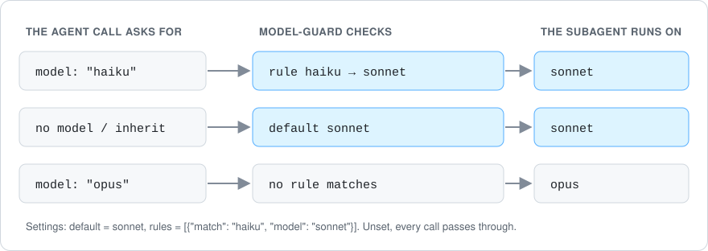

# krasi-mods

If all you want is one model for subagents that don't ask for one, set `CLAUDE_CODE_SUBAGENT_MODEL` and skip this
plugin. **model-guard** is for per-request rules.

Small mods for Claude Code (plugins built on its function hooks), in one marketplace. The first is **model-guard**: it
picks the model each subagent runs on, by rule. It does nothing until you configure it.

<p align="center">
  
</p>

Unofficial; not affiliated with Anthropic.

## Quickstart

1. Install it from a Claude Code session in a terminal:

   ```
   /plugin install model-guard --marketplace KrasimirKralev/krasi-mods
   ```

   Answer `y` to add the marketplace, then pick a scope. The two-step form works too:
   `/plugin marketplace add KrasimirKralev/krasi-mods`, then `/plugin install model-guard@krasi-mods`. The install
   reports its options as not set yet; that is expected, since empty means off.

2. Set a rule. Open `/config` and fill in the `model-guard` rows; a change there reloads the mod at once. Or set it
   from a shell and restart Claude Code:

   ```sh
   echo '{"rules": "[{\"match\": \"haiku\", \"model\": \"sonnet\"}]"}' \
     | claude plugin configure model-guard@krasi-mods --values-stdin
   ```

3. Start a subagent; it runs on the model your rules pick. If a setting is broken, a dim `model-guard: …` line at
   the start of the session says what is wrong.

## Settings

| Row in `/config` | Empty (the default) | Set |
|---|---|---|
| `model-guard.default` | Claude Code decides, as without the mod | The model for a call that names none (leaves `model` out, or passes `inherit`): an alias such as `sonnet`, a full model id, or `inherit` for the main model |
| `model-guard.rules` | No rules | A JSON array of `{"match": "<regex>", "model": "<alias or id>"}`, checked in order against the model a call names |
| `model-guard.forks` | `passthrough`: a fork starts | `deny`: a fork is refused, so the caller starts a regular subagent instead |

The settings are the plugin's own `/config` rows, so Claude Code checks them, keeps them with the rest of your
settings, and reloads the mod when they change. There is no separate file to look after.

## How a spawn is decided

1. **A workflow script's agents** pass through untouched. Claude Code lets a hook refuse one, never change it.
2. **A fork** always runs on the main model; Claude Code ignores `model` for a fork. With `forks` set to `deny`, it is
   refused.
3. **A call that names no model** (leaves `model` out, or passes `inherit`) gets `default`, when it is set.
4. **A call that names a model** gets the `model` of the first rule whose `match` fits. `match` is a case-insensitive
   regular expression. When no rule fits, the call keeps what it asked for.
5. **If `rules` is broken** (not JSON, not an array, a rule with no `match` or `model`, a bad regular expression), no
   rule applies, and the session-start line says which. One broken rule turns them all off, so that a later catch-all
   never takes the requests the broken rule was meant to answer.

A model set by model-guard counts as the call's own, so it also wins over the `model:` line in an agent's definition.
`CLAUDE_CODE_SUBAGENT_MODEL` does not: it only fills in when neither the call nor the definition names a model.

## Before and after

With `default` = `sonnet` and `rules` = `[{"match": "haiku", "model": "sonnet"}]`:

| The Agent call asks for | Claude Code alone runs | With model-guard runs |
|---|---|---|
| no model | the agent definition's model, else `CLAUDE_CODE_SUBAGENT_MODEL`, else the main model | `sonnet` |
| `inherit` | the main model | `sonnet` |
| `haiku` | `haiku` | `sonnet` |
| `opus` | `opus` | `opus` |
| a fork | the main model | the main model (or refused, with `forks` = `deny`) |

## Recipes

**Keep subagents off your main model unless they name one.** Set `default` to the model they should use, for
example `sonnet`. A call that names a model still gets it.

```json
{ "default": "sonnet" }
```

**Lift haiku requests to sonnet.** Every call naming a haiku model, alias or full id, runs on sonnet instead.

```json
{ "rules": "[{\"match\": \"haiku\", \"model\": \"sonnet\"}]" }
```

Both blocks are what `claude plugin configure model-guard@krasi-mods --values-stdin` takes. Both recipes are also tests
(`README recipes` in `plugins/model-guard/tests/model-guard.test.ts`).

## Limits

- It cannot give a subagent a model your account or provider does not offer.
- It does not touch a workflow script's agents (see above).
- Function hooks are an early-access Claude Code API. This version was built and tested on Claude Code 2.1.296.
- It costs no context up front: `claude plugin details model-guard@krasi-mods` projects ~0 always-on tokens.

## Develop

```sh
claude plugin validate plugins/model-guard   # manifest and hooks module
claude plugin validate .                      # the marketplace file
claude plugin test plugins/model-guard        # the tests
claude --plugin-dir plugins/model-guard       # a session with your working copy loaded
```

An interactive session started with `--plugin-dir` lays the API's type declarations into
`plugins/model-guard/.claude-plugin/types/` (gitignored). The plugin's `tsconfig.json` extends them, so
`tsc -p plugins/model-guard` then type-checks it.

## How it was built

model-guard began in October 2026 as a private mod with one hard-coded routing policy, written with Claude Code
against its function-hooks API. This public version replaces that policy with three `/config` settings, ships with no
policy at all, and adds tests for setting parsing, broken input and rule order, run by `claude plugin test`.

## License and credits

MIT, see [LICENSE](LICENSE). Built on Claude Code's plugin and function-hooks API. Unofficial; not affiliated with
Anthropic.

More from [@KrasimirKralev](https://github.com/KrasimirKralev): [Harvest Hollow](https://github.com/KrasimirKralev/harvest-hollow),
a co-op farming game you play in the browser.
